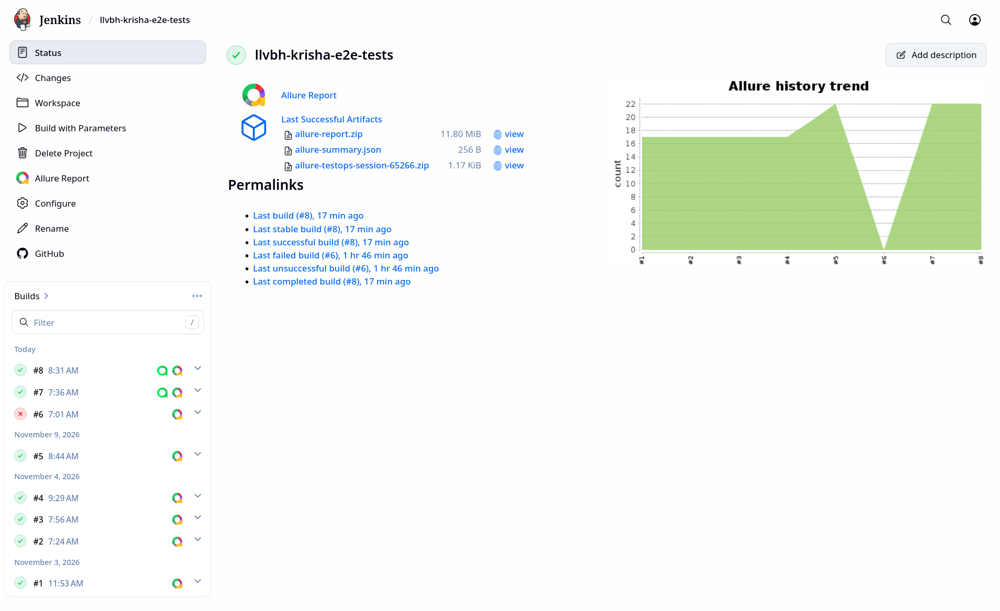
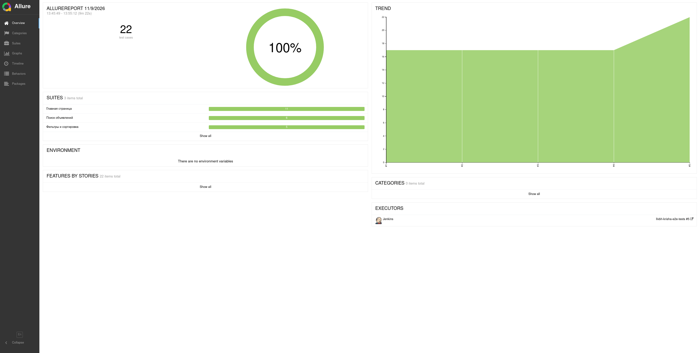
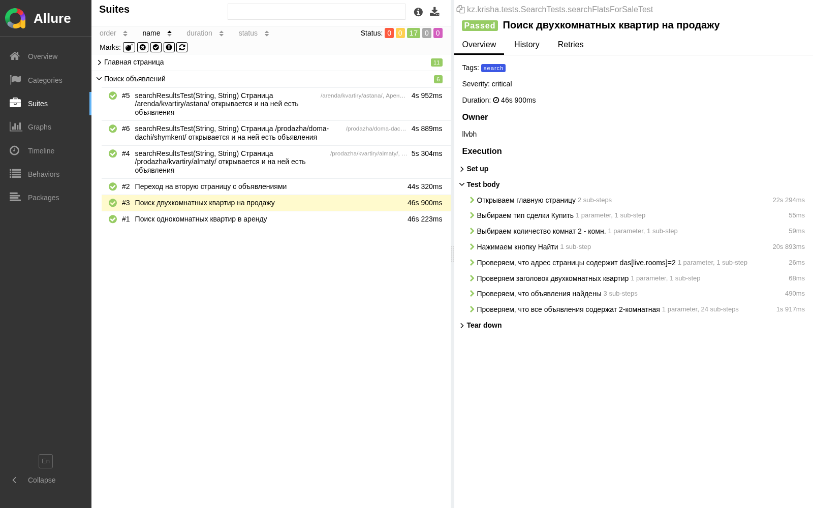
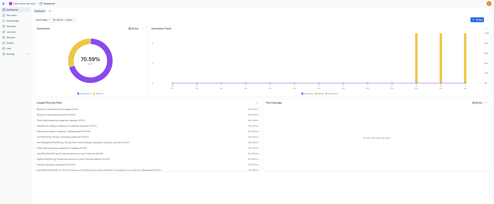
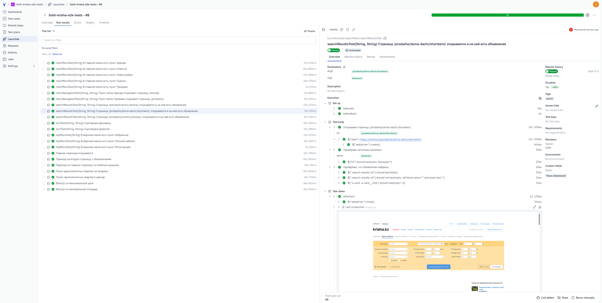
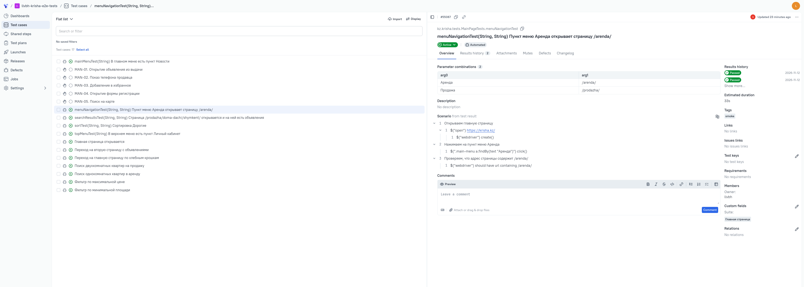
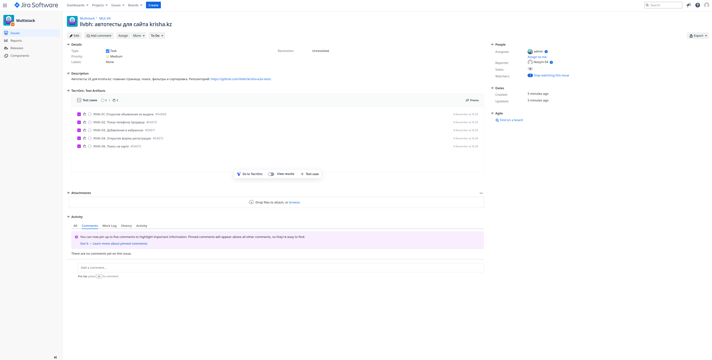
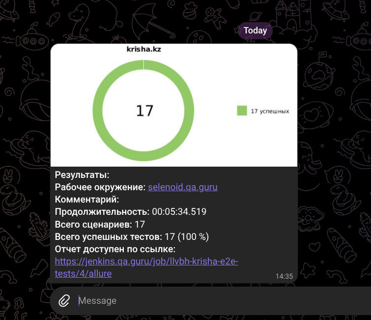

<a id="readme-top"></a>
<p align="center">
<a href="https://krisha.kz/"></a>
</p>

# Проект по тестированию сайта krisha.kz для поиска квартиры

> <a href="https://krisha.kz/">Крыша</a> — сайт объявлений о продаже и аренде недвижимости в Казахстане

## :scroll: Содержание:

- <a href="#tools">Технологии и инструменты</a>
- <a href="#cases">Реализованные тесты</a>
- <a href="#console">Запуск тестов из терминала</a>
- <a href="#jenkins">Сборка в Jenkins</a>
- <a href="#allure">Allure-отчет</a>
- <a href="#testops">Интеграция с Allure TestOps</a>
- <a href="#jira">Интеграция с Jira</a>
- <a href="#telegram">Уведомление в Telegram</a>
- <a href="#video">Видео тестов</a>

<a id="tools"></a>
## :hammer_and_wrench: Использованные инструменты

<p align="center">
<a href="https://www.java.com/"></a>
<a href="https://www.jetbrains.com/idea/"></a>
<a href="https://github.com/"></a>
<a href="https://junit.org/junit5/"></a>
<a href="https://gradle.org/"></a>
<a href="https://selenide.org/"></a>
<a href="https://aerokube.com/selenoid/"></a>
<a href="https://github.com/allure-framework"></a>
<a href="https://qameta.io/"></a>
<a href="https://www.atlassian.com/software/jira"></a>
<a href="https://www.jenkins.io/"></a>
<a href="https://web.telegram.org/"></a>
</p>

Тесты написаны на языке <code>Java</code> с использованием фреймворка [Selenide](https://selenide.org/), сборщик — <code>Gradle</code>. <code>JUnit 5</code> используется для запуска тестов.
Браузеры для удаленного запуска поднимаются в [Selenoid](https://aerokube.com/selenoid/).
Для удаленного запуска сделана джоба в <code>Jenkins</code> с формированием Allure-отчета и отправкой результатов в <code>Telegram</code> при помощи бота.

Allure-отчет включает в себя:
- шаги выполнения тестов
- скриншот страницы на последнем шаге
- исходный код страницы
- логи консоли браузера
- видео выполнения теста

<a id="cases"></a>
## :ballot_box_with_check: Реализованные тесты

### Главная страница
- Главная страница открывается: заголовок, логотип и форма поиска
- В главном меню есть вкладки «Продажа», «Аренда», «Новостройки», «Оценка», «Новости»
- В верхнем меню расположены табы «Избранное», «Регистрация», «Личный кабинет»
- Пункты меню «Продажа» и «Аренда» открывают нужные разделы

### Поиск объявлений
- Поиск двухкомнатных квартир на продажу через форму на главной странице
- Поиск однокомнатных квартир в аренду через форму на главной странице
- Страницы с объявлениями по Алматы, Астане и Шымкенту открываются и содержат объявления
- Переход на вторую страницу с объявлениями

### Фильтры и сортировка
- Фильтр по максимальной цене: все объявления не дороже указанной суммы
- Фильтр по минимальной площади
- Сортировка «Дешевые» и «Дорогие»
- Хлебные крошки: есть текущий раздел и работает переход на главную страницу

<p align="right"><a href="#readme-top">наверх</a></p>

<a id="console"></a>
## :computer: Запуск тестов из терминала

Локальный запуск:
```
./gradlew clean test
```

Запуск по тегам:
```
./gradlew clean smoke_test
./gradlew clean search_test
```

Удаленный запуск в Selenoid:
```
./gradlew clean test -DselenoidLogin=<логин> -DselenoidPassword=<пароль>
```

Дополнительные параметры:
- `-Dbrowser` — браузер, по умолчанию `chrome`
- `-DbrowserVersion` — версия браузера
- `-DbrowserSize` — размер окна, по умолчанию `1920x1080`
- `-DselenoidUrl` — адрес Selenoid, по умолчанию `selenoid.qa.guru`

Сформировать и открыть Allure-отчет:
```
./gradlew allureServe
```

<p align="right"><a href="#readme-top">наверх</a></p>

<a id="jenkins"></a>
##  Сборка в [Jenkins](https://jenkins.qa.guru/job/llvbh-krisha-e2e-tests/)

<p align="center">

</p>

### Параметры сборки в Jenkins:
- `TASK` — какие тесты запускать: `test`, `smoke_test`, `search_test`
- `BROWSER` — браузер, по умолчанию `chrome`
- `BROWSER_VERSION` — версия браузера: `156.0`, `155.0`, `148.0`
- `BROWSER_SIZE` — размер окна браузера, по умолчанию `1920x1080`
- `SELENOID_HOST` — адрес Selenoid, по умолчанию `selenoid.qa.guru`
- `SELENOID_LOGIN`, `SELENOID_PASSWORD` — логин и пароль для Selenoid
- `TELEGRAM_TOKEN`, `TELEGRAM_CHAT` — токен бота и чат для уведомлений

<p align="right"><a href="#readme-top">наверх</a></p>

<a id="allure"></a>
##  [Allure-отчет](https://jenkins.qa.guru/job/llvbh-krisha-e2e-tests/allure/)

### Основная страница отчета

<p align="center">

</p>

### Тест-кейсы

<p align="center">

</p>

<p align="right"><a href="#readme-top">наверх</a></p>

<a id="testops"></a>
##  Интеграция с [Allure TestOps](https://allure.qa.guru/project/5425/dashboards)

Результаты каждой сборки в <code>Jenkins</code> загружаются в <code>Allure TestOps</code>. Проверки, которые нельзя автоматизировать на этом сайте, описаны там же как ручные тест-кейсы.

### Дашборд

<p align="center">

</p>

### Запуск тестов

<p align="center">

</p>

### Автоматизированные и ручные тест-кейсы

<p align="center">

</p>

<p align="right"><a href="#readme-top">наверх</a></p>

<a id="jira"></a>
## [Интеграция с Jira](https://jira.qa.guru/browse/MUL-69)

В задаче на разработку UI-автотестов привязаны ручные тест-кейсы из <code>Allure TestOps</code>.

<p align="center">

</p>

<p align="right"><a href="#readme-top">наверх</a></p>

<a id="telegram"></a>
##  Уведомление в Telegram при помощи бота

После выполнения тестов бот отправляет сообщение с результатами прогона.

<p align="center">

</p>

<p align="right"><a href="#readme-top">наверх</a></p>

<a id="video"></a>
##  Видео прохождения теста

К каждому тесту в отчете прикладывается видео прогона.

<p align="center">

</p>

<p align="right"><a href="#readme-top">наверх</a></p>
